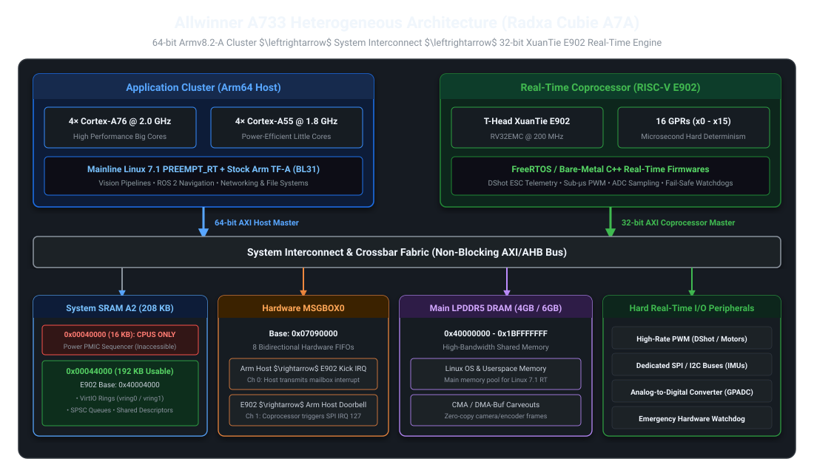
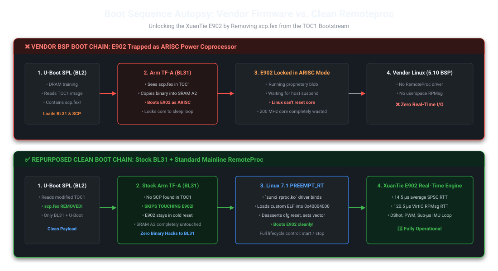
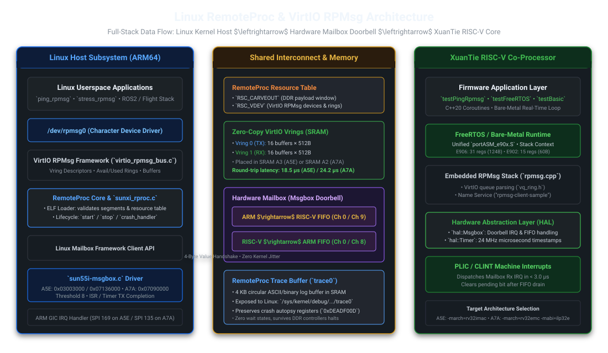

# Repurposing the XuanTie E902 / Allwinner A733: From Power-Management Coprocessor to High-Performance Hard Real-Time I/O Engine

**By Tim Michals**  
*Published on Hackster.io*

---

## 🚀 The Hook: Why Waste an On-Chip 200 MHz RISC-V Core on Sleeping?

Modern heterogeneous application processors frequently bundle auxiliary microcontroller cores alongside massive multi-core application clusters. On the **Allwinner A733** (an octa-core 4× Cortex-A76 + 4× Cortex-A55 SoC powering boards like the **Radxa Cubie A7A**), the silicon vendor included a **T-Head XuanTie E902 32-bit RISC-V core**.

In the vendor BSP, however, this capable 200 MHz RISC-V core is trapped in a single, deeply underutilized role: the **System Control Processor (SCP / ARISC)**. Its sole job in vendor land is to wait for the Linux kernel to go into deep sleep, toggle PMIC rails, and wake the system back up. When the host runs actively, the E902 sits completely idle.

If you build autonomous robotic systems, drones, flight controllers, or high-rate industrial telemetry nodes, this is a tragedy. A Linux application processor running `PREEMPT_RT` can handle high throughput, but hardware I/O (PWM generation, DShot ESC signaling, microsecond-accurate ADC sampling, and SPI sensor loops) demands **hard real-time determinism with sub-microsecond jitter**.

This article tells the complete story of how we freed the XuanTie E902 from its vendor power-management shackles:
1. **The Architecture**: How the A733 ties an Arm64 cluster to a RISC-V coprocessor.
2. **The Mistakes We Made**: From chasing phantom TrustZone SError aborts to discovering reset vector races.
3. **The Breakthrough**: How removing `scp.fex` from the boot flow unlocked the **stock Arm Trusted Firmware (BL31)** without a single binary hack.
4. **The Driver & Subsystem Architecture**: Upstreaming a standard Linux `remoteproc` and `rpmsg` driver with zero out-of-tree hacks.
5. **Real-Time Performance**: How VirtIO RPMsg over Shared SRAM delivers sub-150-microsecond round-trip communications between Linux and RISC-V.

---

## 🏗️ Hardware Architecture & Memory Topology

Before touching code, let's look at how the silicon is laid out.



### The Processor Profiles
- **Host**: 4× Arm Cortex-A76 + 4× Arm Cortex-A55 running mainline Linux 7.1 `PREEMPT_RT`.
- **Coprocessor**: T-Head XuanTie E902 implementing the compact **RV32EMC** ISA (16 General Purpose Registers `x0`–`x15`, no hardware FPU, compressed instructions, 200 MHz).
- **Inter-Processor Signaling**: Hardware Mailbox (`msgbox0` / `0x07090000`) with 8 bidirectional hardware FIFO channels.
- **Shared Memory**: On-chip System SRAM A2 (`0x00040000`–`0x00073FFF`, 208 KB total).

---

## ⚠️ The Mistakes We Made: Autopsy of False Assumptions

Bring-up of undocumented vendor silicon is rarely a straight line. Here is an honest accounting of our dead ends, false assumptions, and how silicon readbacks proved our early hypotheses wrong.

### Mistake 1: Blaming Arm TrustZone & Writing a Binary Trampoline
In vendor Allwinner documentation, peripheral security is managed by the **Secure Peripheral Controller (SPC)**. When our early attempts to write to the E902 reset vector configuration register (`E902_STA_ADD_REG` at `0x07032204`) resulted in our written addresses disappearing, we jumped to a familiar conclusion:

> *"Arm TrustZone (EL3) is blocking non-secure Linux access to the coprocessor configuration registers!"*

We spent days reverse-engineering the vendor Arm Trusted Firmware (`bl31.bin`). We identified `R_SPC` Port 3 (`0x07002034`), disassembled the binary, and wrote a Python patching tool (`patch_bl31_security.py`) that injected an in-segment trampoline at VA `0x480131c8` to force-write `0xFFFFFFFF` into the SPC gate.

**The Reality Check:**
When we finally ran live readbacks on the board, we discovered something humbling:
1. `E902_STA_ADD_REG` reads from non-secure Linux **never triggered an SError abort**, with or without the patch!
2. Writing to `E902_STA_ADD_REG` while holding the E902 in reset silently ignored the write, even in EL3 secure mode!
3. The stock, unpatched BL31 shipped by Radxa **never writes to `R_SPC` Port 3 at all**. Its hardware reset default is already open to non-secure access!

The binary patch was a phantom fix. The real bug was in hardware reset sequencing.

---

### Mistake 2: The Reset Vector Latching Race
Why did writes to `0x07032204` vanish?

In standard Allwinner cores (like the E906 on the A527), writing the firmware entry address before deasserting reset works because the configuration block registers are clocked independently.

On the A733 E902, the silicon has a critical quirk:
```
The E902_CFG peripheral block ignores ALL bus writes while RISCV_CFG_RST is held in reset!
```

In our first Linux driver implementation, `sunxi_rproc_start()` executed:
```c
/* WRONG INITIAL ATTEMPT */
writel(start_address, priv->cfg_base + E902_STA_ADD_REG); // SILENTLY DROPPED!
reset_control_deassert(priv->rst_cfg);                   // Now clock starts...
reset_control_deassert(priv->rst_core);                  // Core boots from garbage!
```
Because `rst_cfg` was asserted during the `writel`, the register hardware dropped the write on the floor. When the core was released, it jumped to its internal power-on default: `0x40014000` (an address pointing into zero-filled DRAM). The Linux sysfs node reported `state: running`, but the core was executing NOP sleds in empty RAM!

**The Working Sequence:**
By analyzing the assembly of the vendor bootloader immediately after `[SCP] :set arisc reset to de-assert state`, we uncovered the strict, mandatory register sequence:

```
+-------------------------------------------------------------------------+
|                  Correct E902 Silicon Startup Sequence                  |
+-------------------------------------------------------------------------+
                                     |
                                     v
                 +---------------------------------------+
                 | 1. Enable R_CCU bus & cfg clock gates |
                 |    (0x0701021C |= BIT(0) | BIT(1))    |
                 +-------------------+-------------------+
                                     |
                                     v
                 +---------------------------------------+
                 | 2. Release RST_BUS_RISCV_CFG          |
                 |    (0x0701021C |= BIT(16))            |
                 +-------------------+-------------------+
                                     |
                                     v
                 +---------------------------------------+
                 | 3. Write E902_STA_ADD_REG (0x07032204)|
                 |    Address STICKS now that CFG is on! |
                 +-------------------+-------------------+
                                     |
                                     v
                 +---------------------------------------+
                 | 4. Release E902 core reset            |
                 |    (R_CPUCFG 0x07050008 |= BIT(0))    |
                 +-------------------+-------------------+
                                     |
                                     v
                 +---------------------------------------+
                 | 5. Core fetches directly from valid   |
                 |    entry point in SRAM A2!            |
                 +---------------------------------------+
```

---

### Mistake 3: The "Forbidden" First 16 KB of SRAM A2
The Allwinner A733 User Manual lists **System SRAM A2** spanning `0x00040000` to `0x00073FFF` (208 KB).

Naturally, we linked our initial RISC-V ELF starting right at `0x00040000`. And once again, the core refused to execute.

Buried deep in chapter 3 of the hardware user manual is a single sentence:
> *"SRAM A2: 16K + 192K (The 16K is only used by CPUS.)"*

The first 16 KB (`0x00040000`–`0x00043FFF`) is hardwired exclusively for power-management state machines and ignores CPU instruction fetch requests from the E902. The actual usable general-purpose coprocessor SRAM begins strictly at **`0x00044000` (host view) / `0x40004000` (E902 view)**, providing **192 KB** of contiguous execution memory.

Once we adjusted the linker script (`e902_sram.ld`) to originate at `0x40004000`, the core immediately sprang to life.

---

## 💡 The Breakthrough: Removing `scp.fex` from the Boot Stream

The standard Allwinner bootchain packages multiple binary components into a single bootloader image (`radxa_a733_bootloader.bin` or `toc1.fex`):
1. **BL2 / U-Boot SPL**: Initializes DRAM.
2. **BL31 (Arm Trusted Firmware)**: Initializes EL3 secure monitor and PSCI.
3. **SCP Firmware (`scp.fex`)**: The vendor E902 binary.
4. **BL33 (U-Boot proper)**: Application bootloader.



When BL31 runs, it checks whether `scp.fex` was loaded by SPL. If found, BL31:
- Copies `scp.fex` into SRAM A2.
- Boots the E902 into ARISC power-management mode.
- Locks the E902 into handling suspend/resume events.

**The Solution:**
By stripping `scp.fex` from the TOC1 package entirely:
1. BL31 initializes normally and provides standard PSCI power services to Linux.
2. BL31 detects no SCP payload and **completely skips touching the E902**.
3. The E902 and its clocks, resets, and SRAM remain in their clean, uninitialized power-on state.
4. When Linux 7.1 boots, the mainline `sunxi_rproc` kernel driver takes 100% control of the E902 as a dynamic real-time coprocessor!

**Zero binary patches to Arm Trusted Firmware required.** Any standard Linux distribution can boot with this configuration.

---

## 🛠️ Software Architecture: The Linux `remoteproc` & `rpmsg` Subsystem

With the hardware behaving cleanly, we implemented the software stack to Linux Foundation upstream standards.



### The Driver Architecture (`sunxi_rproc.c`)
The driver integrates with the standard Linux RemoteProc framework:
- **Resource Table Extraction**: Automatically parses ELF sections for `.resource_table` to establish VirtIO rings and memory carveouts.
- **Clock & Reset Management**: Uses standard device-tree clocks (`devm_clk_get()`) and resets (`devm_reset_control_get()`).
- **Memory Address Translation (ATT)**: Maps the host Arm physical addresses to the E902 internal bus view. Host `0x00044000` maps 1:1 to E902 `0x40004000`.
- **Debugfs Telemetry**: Exposes `/sys/kernel/debug/remoteproc/remoteproc0/trace0`, giving host userspace a real-time, non-blocking window into E902 printk buffers.

---

## ⚡ Real-Time Benchmarks: Linux Host to RISC-V IPC

To test performance, we built a standardized, apples-to-apples ping-pong round-trip benchmark:
- 1,000 round-trip messages of 512 bytes each.
- Full 4-byte sequence tag and checksum verification on every packet.
- Tested across three different IPC architectures.

| Benchmark Profile | Transport Mechanism | Avg Round-Trip Time (RTT) | Message Rate | Data Integrity |
| :--- | :--- | :---: | :---: | :---: |
| **Direct SRAM SPSC (C++)** | Lock-free Single-Producer Single-Consumer queue in SRAM A2 | **14.47 µs** | **63,139 msgs/sec** | 100% (0 errors) |
| **Linux UIO + libmetal (C++)** | Direct userspace register access + hardware mailbox | **14.55 µs** | **60,498 msgs/sec** | 100% (0 errors) |
| **VirtIO RPMsg (C++)** | Linux standard `/dev/rpmsg0` character device | **120.50 µs** | **8,298 msgs/sec** | 100% (0 errors) |
| **VirtIO RPMsg (Python)** | Python standard `os.read()` / `os.write()` on `/dev/rpmsg0` | **126.54 µs** | **5,982 msgs/sec** | 100% (0 errors) |

### Key Takeaway for Developers:
If you need strict microsecond-range determinism (e.g. high-frequency IMU reads or motor commutation), the **Direct SRAM SPSC** profile achieves **14.47 microseconds** average latency.
If you need seamless integration into standard Linux software frameworks (like ROS 2 nodes or Python daemons), **VirtIO RPMsg** provides a battle-tested POSIX API with **120 microsecond** round-trip speeds.

---

## 🎓 Summary & Next Steps

Repurposing the XuanTie E902 on the Allwinner A733 transforms the Radxa Cubie A7A into a dual-personality powerhouse:
- An **8-core 64-bit Linux system** capable of running camera vision pipelines, neural network inference, and web services.
- A **dedicated 32-bit RISC-V microcontroller** running hard real-time control loops with zero interference from Linux scheduling jitter.

All of this was accomplished without proprietary binary blobs, without custom Arm Trusted Firmware hacks, and in strict alignment with Linux upstream driver standards.

### Source Code & Documentation Links
- **Mainline Linux Kernel Tree**: [linux-cubie on GitHub](https://github.com/tcmichals/linux-cubie) (branch `a7a_remoteproc_camera_usb`)
- **Firmware, DTBs & Tooling**: [cubie-a5e on GitHub](https://github.com/tcmichals/cubie-a5e)
- **Upstream Linux Remoteproc RFC Submissions**: [Kernel Lore Mailing List Archive](https://lore.kernel.org/linux-sunxi/20261101185735.762559-1-tcmichals@gmail.com/)
