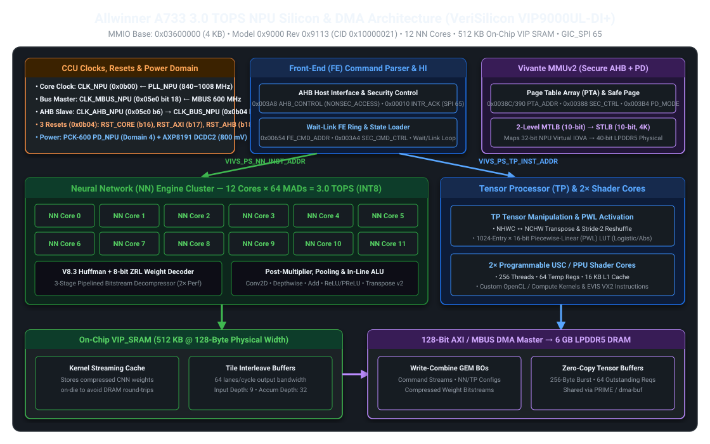

# Freeing the 3.0 TOPS NPU on the Allwinner A733: How an On-Die Neural Accelerator Works, Mainline Linux `etnaviv` + Mesa Teflon Bring-Up, and Zero-Copy Video Processing

**By Tim Michals**  
*Featured for Hackster.io — Open-Source Edge AI, Mainline Linux & Embedded Vision*

---

## 🚀 1. Basic Info & Introduction: What Does an On-Die NPU Actually Do?

If you have ever deployed a computer vision model (like YOLOv8, MobileNetV2, or PoseNet) on an embedded Linux single-board computer, you have felt the wall that general-purpose CPU cores hit when processing real-time 1080p video.

Even on a modern octa-core processor like the **Allwinner A733** (2× Arm Cortex-A76 @ 2.0 GHz + 6× Cortex-A55 @ 1.8 GHz, powering the **Radxa Cubie A7A**) or the **Allwinner T527** (8× Cortex-A55 @ 1.8 GHz, powering the **Radxa Cubie A5E**), running millions of multiply-accumulate operations per frame on the CPU means:
- Burning **3–5 Watts** of CPU thermal budget on matrix math instead of application logic.
- Saturating the CPU's L1/L2 caches and external DRAM bus by repeatedly fetching weights and writing intermediate feature maps.
- Dropping frames whenever the CPU also has to handle camera capture, H.264/H.265 video encoding, or network streaming.

To solve this, silicon designers place a dedicated **Neural Processing Unit (NPU)** right on the SoC die. On the **Allwinner A733**, that NPU is a **3.0 TOPS VeriSilicon Vivante VIP9000UL-DI+ (`npu@3600000`)**; on the **Allwinner T527**, it is a **2.0 TOPS VeriSilicon Vivante VIP9000Nano-SI+ (`npu@7120000`)**.

### How Does an NPU Work Compared to a CPU or GPU?

Unlike a CPU (which fetches scalar or small SIMD instructions one by one) or a GPU (which runs general-purpose 32-bit floating-point shaders), a neural network accelerator is a **spatial dataflow engine** purpose-built around four hardware principles:

1. **8-Bit Quantized Tensor Math (`INT8` / `UINT8`)**:
   Neural networks trained in 32-bit floating point (`FP32`) are quantized to 8-bit integers (`INT8` or `UINT8`) using per-tensor or per-channel scale and zero-point parameters. An 8-bit integer multiply-accumulate (**MAC**) circuit takes roughly **15–20× less silicon area and switching energy** than an `FP32` fused multiply-add, allowing the A733 NPU to pack **768 parallel INT8 MAC units** (**1,536 INT8 operations per clock cycle**) into a tiny silicon footprint.
2. **Spatial Weight & Activation Broadcast Across 12 NN Cores**:
   In a 2D convolution ($3 \times 3$ or $1 \times 1$), the exact same kernel weights slide across thousands of $(x, y)$ pixel locations, while the same input pixel patch is multiplied against dozens of output channels. Instead of reading weights from DRAM over and over, the NPU loads weights and input tiles once into **512 KB of ultra-wide on-chip VIP SRAM** (**128 bytes / 1024 bits per cycle** on the A733) and broadcasts them simultaneously across **12 Neural Network (NN) cores**.
3. **On-the-Fly Hardware Weight Decompression (Huffman + ZRL)**:
   Neural network weights contain large runs of zeros and clustered small integer values. When a model is loaded, its weights are compressed using **Huffman coding and Zero-Run-Length (ZRL)** encoding. Inside the NPU, a dedicated hardware bitstream decoder decompresses weights at 128 bytes/cycle as DMA streams them from LPDDR5—cutting external memory bandwidth by **2–4×** with zero CPU overhead.
4. **Fused Hardware Pooling, Activation & Requantization**:
   Before a partial sum ever leaves an NN core, dedicated inline stages apply 32-bit bias addition, non-linear activation (`ReLU`, `ReLU6`, `Clamp`), $2 \times 2$ max or average pooling, and 8-bit requantization in a single pass. Structural tensor operations (planar transpose, channel reshuffle, padding, and lookup-table activations like `Sigmoid` / `Logistic` or `Tanh`) run on a companion **Tensor Processor (TP)** and **Programmable Shader / PPU** engine.

### Allwinner A733 (3.0 TOPS) vs. Allwinner T527 / A527 (2.0 TOPS): What Changed in Silicon?

A common misconception is that the A733 and T527 share the exact same NPU block. Both belong to the VeriSilicon **Vivante VIP9000** family (`CHIP_MODEL = 0x9000`), which means they share the same Vivante V8.3 descriptor format—**but they are very different silicon implementations**.

Silicon register readbacks (`0x00018..0x00094`) and VeriSilicon's hardware feature database (`gc_feature_database.h`) reveal why the A733 delivers **3.0 TOPS** while the T527 delivers **2.0 TOPS**:

| Hardware Parameter | Allwinner A733 (Radxa Cubie A7A) | Allwinner T527 / A527 (Radxa Cubie A5E) | What It Means in Practice |
| :--- | :--- | :--- | :--- |
| **Silicon IP Name** | **VeriSilicon VIP9000UL-DI+** | **VeriSilicon VIP9000Nano-SI+** | Distinct Vivante V8.3 IP configurations |
| **Peak Throughput** | **3.0 TOPS** (`INT8`) | **2.0 TOPS** (`INT8`) | **1.5× higher** convolution throughput on A733 |
| **MMIO Base Address** | `0x03600000` (`128 KB`) | `0x07120000` (`128 KB`) | Mapped on NPU system bus vs. MCU domain |
| **GICv3 Interrupt** | `GIC_SPI 65` | `GIC_SPI 157` | Signals Front-End (`FE`) command completion |
| **Vivante Chip Model** | `0x9000` | `0x9000` | Shared `VIP9000` family ID |
| **Chip Revision (`0x00024`)** | **`0x9113`** | **`0x9003`** | Distinguishes A733 (`0x9113`) from T527 (`0x9003`) |
| **Product / Customer / ECO ID** | `0x0509000b` / `0x10000021` / `0x0c000000` | `0x05090009` / `0x10000016` / `0x06000000` | Exact lookup key in `gc_feature_database.h` |
| **NN Core Count** | **12 NN Cores** | **6 NN Cores** | A733 doubles the parallel convolution MAC array |
| **INT8 MADs per NN Core** | 64 MADs/core (**1,536 INT8 ops/cycle**) | 64 MADs/core (**768 INT8 ops/cycle**) | At ~960 MHz–1.0 GHz, $12 \times 64 \times 2 \text{ ops} \times f \approx 3.0\text{ TOPS}$ |
| **NN Core Kernel XY Size** | $4 \times 4$ (`NN_CORE_KERNEL_XY_SIZE = 4`) | $3 \times 3$ (`NN_CORE_KERNEL_XY_SIZE = 3`) | Larger spatial window per cycle on A733 |
| **NN ZDP Engine** | **ZDP3** (`NN_ZDP3 = 1`) | **ZDP6** (`NN_ZDP6 = 1`) | Different Zero-Data-Path spatial tiling layout |
| **VIP SRAM Size & Bus Width** | **512 KB @ 128-Byte Width** (`1024-bit`) | **512 KB @ 64-Byte Width** (`512-bit`) | A733 has **2× wider** internal VIP SRAM bandwidth |
| **TP / PPU Shader Cores** | `TPEngine_CoreCount = 0` (`TP_ENGINE = 1`), **2 Shader Cores** | **2 TP Cores**, **1 Shader Core** | A733 executes TP & PPU tensor kernels across 1 TP / 2 Shader units |
| **MMUv2 Page Descriptor (`0x003B4`)** | **`MMU_PAGE_DESCRIPTOR = 1`** | `MMU_PAGE_DESCRIPTOR = 0` | A733 requires `0x003B4` flat-fetch bypass (`0x2` $\rightarrow$ `0x1`) during MMU init |
| **Reset Lines** | **3 resets** (`CORE`, `AXI`, `AHB`) | **1 reset** (`RST_BUS_NPU`) | A733 requires multi-reset array control in `etnaviv` |

---

## 🔓 2. Breaking Out of the Proprietary Vendor Trap: Why Mainline `etnaviv` + Mesa Teflon?

Traditionally, using a Vivante VIP9000 NPU on an Allwinner SoC meant accepting a locked-down vendor BSP stack:
* **Kernel Space**: A ~44,000-line out-of-tree kernel module (`vipcore.ko` or `galcore.ko` exposing `/dev/vipcore` or `/dev/galcore`) that breaks on every minor Linux kernel upgrade (`EXTRA_CFLAGS` removal, `in_irq()` deprecation, `MAX_ORDER` rename, `platform_driver` `.remove` signature changes).
* **Userspace**: Precompiled closed-source shared libraries (`libVIPlite.so`, `libVIPuser.so`, or `TIM-VX`) tied to a specific glibc/Android ABI.
* **Offline Model Lock-In**: You cannot load a standard `.tflite` model directly. Instead, you must run a proprietary x86 offline compiler (`acuity-toolkit` / `pegasus`) to convert your model into a locked `.nb` (`network_binary.nb`) blob tailored to a single chip revision.

To run on **mainline Linux 7.1** with zero binary blobs, we replaced the entire vendor stack with upstream open-source components:

| Feature | Legacy Vendor Stack (`vipcore` / `VIPlite`) | Mainline Open-Source Stack (`etnaviv` + Mesa Teflon) |
| :--- | :--- | :--- |
| **Kernel Driver** | Out-of-tree 44K-line `vipcore.ko` / `galcore.ko` | In-tree mainline **`drivers/gpu/drm/etnaviv/`** (`CONFIG_DRM_ETNAVIV=y`) |
| **Device Node & Memory API** | Custom `/dev/vipcore` ioctl ABI | Standard Linux DRM render node **`/dev/dri/renderD128`**, GEM & **`dma-buf` PRIME** |
| **Userspace AI Interface** | Proprietary `libVIPlite.so` / `TIM-VX` blobs | Open-source **Mesa 26.1.8 Teflon** (`libteflon.so`) TFLite external delegate |
| **Model Format** | Proprietary offline-compiled `.nb` binary | **Standard quantized `.tflite` models** compiled on the fly at load time |
| **Multi-Process Safety** | Shared global address space | Per-process **MMUv2 virtual page tables** + **`drm_gpu_scheduler`** hang recovery |

---

## 🔬 3. Inside the Chip: How the A733 3.0 TOPS NPU Works (Clocks, MMUv2, DMA & 12 NN Cores)

To understand what happens inside the silicon at `0x03600000` when an AI inference job runs—and why specific clock, reset, and MMUv2 registers had to be unlocked for the Allwinner A733—let's trace the internal hardware blocks from the power rail down to the 12 NN cores.



### 3.1 Power Domain, 4-Clock CCU Hierarchy & Triple Reset Lines

Before a single register at `0x03600000` responds to CPU reads, three hardware prerequisites must be satisfied in strict order:

1. **Power Supply & Silicon Island (`AXP8191 dcdc2` + `PCK-600 PD_NPU`)**:
   * The external `vdd-gpu-npu` power rail is driven by the **AXP8191 PMIC `dcdc2` buck converter** (`500–1540 mV`, ~0.9 V nominal).
   * Inside the A733 SoC, the **PCK-600 Power Controller** (`pck600@7090000`) controls power isolation for the NPU island via domain **`PD_NPU` (`5`)**. When `etnaviv` calls `pm_runtime_resume_and_get()`, Linux `genpd` powers on `PD_NPU` and releases isolation clamps.
2. **The 4-Clock Tree in Mainline `ccu-sun60i-a733.c`**:
   * **`CLK_NPU` (`0x0b00`, `"core"`)**: The high-speed compute clock driving the 12 NN cores and 512 KB VIP SRAM, muxed across `pll-npu-4x`, `pll-ve0`, `pll-ve1`, and `pll-periph0-800M/600M/480M` with a 5-bit divider (`M`) and gate `BIT(31)`.
   * **`CLK_AHB_NPU` (`0x05c0` bit 6) $\rightarrow$ `CLK_BUS_NPU` (`0x0b04` bit 0, `"reg"`)**: On the A733, CPU register reads/writes to `0x03600000` traverse **two series AHB clock gates**: the top-level NPU AHB master gate (`0x05c0` bit 6) and the NPU module bus gate (`0x0b04` bit 0). In `drivers/clk/sunxi-ng/ccu-sun60i-a733.c`, we parented `bus_npu_clk` (`CLK_BUS_NPU`) directly to `ahb_npu_clk` (`CLK_AHB_NPU`). That way, when `etnaviv` enables its `"reg"` clock, the Linux Common Clock Framework automatically enables **both** `0x05c0[6]` and `0x0b04[0]`.
   * **`CLK_MBUS_NPU` (`0x05e4` bit 2, `"bus"`)**: Gates the 128-bit AXI/MBUS DMA master port, parented to `mbus_clk` (`600 MHz` from `pll-periph0-600M`, synced with Junhui Liu's upstream A733 CCU `v7` patch series). If `CLK_MBUS_NPU` is left gated, MMIO register reads work fine, but the NPU's DMA engine stalls forever the moment it tries to fetch its first command buffer from LPDDR5!
3. **Triple Reset Lines (`0x0b04` bits 16, 17, 18)**:
   * Unlike the T527 (which has a single `RST_BUS_NPU` bit), A733 register `0x0b04` splits the NPU reset into three active-low lines: **`RST_BUS_NPU_CORE` (`bit 18`)**, **`RST_BUS_NPU_AXI` (`bit 17`)**, and **`RST_BUS_NPU_AHB` (`bit 16`)**.
   * Mainline `etnaviv` previously called `devm_reset_control_get_optional()`, which only supports a single reset line. By switching `etnaviv_gpu_platform_probe()` to `devm_reset_control_array_get_optional_exclusive(&pdev->dev)` (and updating `vivante,gc.yaml` to `maxItems: 3`), `etnaviv` cleanly asserts and deasserts all three reset lines as a unit.

### 3.2 The Front-End (FE) Wait-Link DMA Command Parser

How does the NPU execute a multi-layer neural network without CPU intervention between layers?

At the front of the NPU sits the **Front-End (FE) Command Parser**. It is a dedicated DMA state machine that reads 64-bit instructions (`LOAD_STATE`, `END`, `NOP`, `WAIT`, `LINK`, `STALL`) directly from system memory:

* **Wait-Link Ring Buffer**: The kernel maintains a small circular ring buffer in DMA memory ending in a 16-byte **`WAIT` (`200 cycles`) $\rightarrow$ `LINK` (back to `WAIT`)** loop. While the NPU is idle or finishing a job, the FE parser continuously loops between those two instructions.
* **Dynamic Job Chaining**: When userspace submits an inference command stream, the kernel writes a `LINK` instruction at the end of the user buffer pointing back to the kernel's new `WAIT -> LINK` tail, and then overwrites the previous `LINK` target in the active ring to jump into the user's command stream. The FE seamlessly follows the new link on its very next cycle without ever stopping.
* **Why `ETNA_SEC_KERNEL` (`0x003A4`) Is Mandatory**: The VIP9000UL-DI+ implements Vivante's Security AHB feature (`MINOR_FEATURES7_BIT_SECURITY` + `MINOR_FEATURES10_SECURITY_AHB`). On this hardware, the legacy `VIVS_FE_COMMAND_CONTROL` (`0x00658`) kick register is a no-op. By adding the Allwinner `0x9000` NPU entries (`0x8303`, `0x9003`, `0x9113`, `0x9202`) to the kernel's `etnaviv_hwdb.c`, `etnaviv` enables `gpu->sec_mode = ETNA_SEC_KERNEL`: it unlocks non-secure register writes at `0x003A8`, writes the command buffer address to `VIVS_FE_COMMAND_ADDR` (`0x00654`), and starts the FE via **`VIVS_MMUv2_SEC_COMMAND_CONTROL` (`0x003A4`)**.

### 3.3 MMUv2 Virtual Memory & The A733 `0x003B4` Page Descriptor Handshake

Every memory address inside an NPU job—the command buffer, compressed weights, bias tables, input feature maps, and output tensors—is a **32-bit NPU Virtual Address (`NPU_VA`)**.

1. **Two-Level Page Walk (`PTA` $\rightarrow$ `MTLB` $\rightarrow$ `STLB`)**:
   * The NPU's internal **MMUv2** translates every 32-bit `NPU_VA` into a **40-bit LPDDR5 Physical Address (`PA`)** using a Page Table Array (`PTA` at `0x0038C`/`0x00390`), a 1024-entry Master TLB (`MTLB`, bits `[31:22]`), and 1024-entry Slave TLB page tables (`STLB`, bits `[21:12]`, 4 KB pages).
   * Because the MMU translates scatter-gather physical pages into a contiguous virtual range, large neural network weight buffers do **not** need physically contiguous CMA memory—standard paged Linux GEM buffers work out of the box.
2. **The Revision `0x9113` `MMU_PAGE_DESCRIPTOR` (`0x003B4`) Discovery**:
   * On the T527 (`0x9003`), `etnaviv_iommuv2_restore_sec()` initializes MMUv2 by running a 16-byte physical-mode command buffer on the FE (`load_state(VIVS_MMUv2_PTA_CONFIG)` + `END`) and then writing `0x00388 = 0x1` (`VIVS_MMUv2_CONFIGURATION`).
   * On the A733 (`0x9113`), VeriSilicon enabled hardware feature **`MMU_PAGE_DESCRIPTOR = 1`** controlled by register **`0x003B4`**. Without programming `0x003B4`, the FE stalls when trying to fetch the physical bootstrap command buffer before MMUv2 is turned on.
   * Matching `_FuncExecute_MMU_CMD` in VeriSilicon's hardware HAL (`gc_hal_kernel_hardware_func.c:3335-3469`), we updated `etnaviv_iommuv2_restore_sec()` in `drivers/gpu/drm/etnaviv/etnaviv_iommu_v2.c` to write **`0x003B4 = 0x2`** (flat physical command-fetch bypass) before kicking the FE PTA bootstrap buffer, wait for FE idle (`0x00004 == 0x7fffffff`), write **`0x003B4 = 0x1`** (Page Descriptor mode active), and then enable `0x00388 = 0x1`.

### 3.4 Inside the Compute Engines: 12 NN Cores, V8.3 Weight Decoder, TP Cores & 512 KB VIP SRAM

Once the FE parses a layer kick (`VIVS_NTE_DESCRIPTOR_UNK14C40` at `0x14C40`), the actual tensor math runs across three internal blocks wired to the **512 KB on-chip VIP SRAM**:

* **12 Parallel NN Cores (Convolution & Matrix Engine)**:
  When bit 0 of `0x14C40` is `0` (an **NN job**), the NPU fetches a 128-byte **`etna_nn_params` descriptor** from `VIVS_NTE_DESCRIPTOR_ADDR`. The **V8.3 Hardware Weight Bitstream Decoder** streams Huffman + Zero-Run-Length compressed weights from LPDDR5 into the **512 KB VIP SRAM** at 128 bytes/cycle, while all **12 NN cores** execute 64 `INT8` MACs/cycle in parallel (**1,536 INT8 ops/cycle**). Intermediate feature tiles stay inside the 512 KB VIP SRAM (mapped via `VIVS_GL_OCB_REMAP_START/END`, `0x03888`/`0x0388C`) to minimize external DRAM traffic.
* **Tensor Processor (TP) & 2 Programmable Shader / PPU Cores**:
  When bit 0 of `0x14C40` is `1` (a **TP job**), the TP engine fetches its configuration from `VIVS_PS_TP_INST_ADDR` (`0x01090`) to perform planar transpose/detranspose, channel reshuffling, tensor padding, and lookup-table non-linear activations (`Sigmoid`/`Logistic`, `Tanh`, `LeakyReLU`), while the 2 PPU shader cores handle strided depthwise preprocessing.

---

## 🧩 4. How It Interfaces: The 4-Layer Open-Source Driver & AI Stack

How does a Python script or C/C++ application loading a standard `.tflite` file end up driving 12 NN cores through `/dev/dri/renderD128`? The software stack is cleanly split into four layers.


### 4.1 Layer 1: Application & TensorFlow Lite Runtime (`libtensorflow-lite.so`)

Your application uses the standard **TensorFlow Lite C API** (`<tensorflow/lite/c/c_api.h>`) or Python `tflite_runtime`. You do not link against any proprietary NPU SDK. Instead, you load Mesa's `/usr/lib/libteflon.so` as a standard TFLite external delegate plugin (`tflite_plugin_create_delegate`):

```c
#include <dlfcn.h>
#include <tensorflow/lite/c/c_api.h>

typedef TfLiteDelegate* (*create_delegate_fn)(char**, char**, size_t,
                                              void (*)(const char*));
typedef void (*destroy_delegate_fn)(TfLiteDelegate*);

void run_npu_inference(const char *model_path) {
    /* 1. Dynamically load Mesa's open-source Teflon TFLite delegate */
    void *teflon_so = dlopen("/usr/lib/libteflon.so", RTLD_LAZY);
    create_delegate_fn create_delegate =
        (create_delegate_fn)dlsym(teflon_so, "tflite_plugin_create_delegate");
    destroy_delegate_fn destroy_delegate =
        (destroy_delegate_fn)dlsym(teflon_so, "tflite_plugin_destroy_delegate");

    TfLiteDelegate *npu_delegate = create_delegate(NULL, NULL, 0, NULL);

    /* 2. Attach the NPU delegate to TFLite InterpreterOptions */
    TfLiteModel *model = TfLiteModelCreateFromFile(model_path);
    TfLiteInterpreterOptions *opts = TfLiteInterpreterOptionsCreate();
    TfLiteInterpreterOptionsAddDelegate(opts, npu_delegate);

    /* 3. Create interpreter: Teflon partitions supported INT8/UINT8 subgraphs */
    TfLiteInterpreter *interp = TfLiteInterpreterCreate(model, opts);
    TfLiteInterpreterAllocateTensors(interp);

    /* 4. Fill input tensor, run on the 3.0 TOPS NPU, read output tensor */
    TfLiteInterpreterInvoke(interp);

    TfLiteInterpreterDelete(interp);
    TfLiteInterpreterOptionsDelete(opts);
    TfLiteModelDelete(model);
    destroy_delegate(npu_delegate);
    dlclose(teflon_so);
}
```

Or in Python (`ctypes` or `tflite_runtime`):
```python
# Or run our built-in zero-dependency verification & benchmark utility:
#   npu-smoke-test /path/to/model_quant.tflite 50
```

### 4.2 Layer 2: Mesa Teflon Delegate Frontend (`src/gallium/frontends/teflon/`)

When `TfLiteInterpreterCreate()` and `TfLiteInterpreterAllocateTensors()` execute:
1. **DRM Render Node Discovery**: Teflon opens `/dev/dri/renderD128` via `pipe_loader_drm_probe_fd()` and instantiates a Gallium `pipe_screen` and `pipe_context` backed by `etnaviv`.
2. **Automatic Graph Partitioning (`Prepare`)**: Teflon walks every node in the `.tflite` flatbuffer graph. Supported quantized (`INT8` / `UINT8`) operators—**`CONV_2D`**, **`DEPTHWISE_CONV_2D`**, **`FULLY_CONNECTED`** (lowered to $1 \times 1$ convolution), **`ADD`**, **`AVERAGE_POOL_2D`**, **`MAX_POOL_2D`**, **`PAD`**, **`LOGISTIC`**, and fused **`RELU` / `RELU6`**—are claimed by the Teflon delegate and merged into contiguous NPU subgraphs. Any unsupported operator (such as a final `SOFTMAX` dequantization node) automatically remains on the Arm CPU.
3. **Lowering to Gallium ML**: Teflon converts the partitioned TFLite subgraph into an array of hardware-agnostic Gallium `struct pipe_ml_operation` descriptors and hands them to `context->ml_subgraph_create()`.

### 4.3 Layer 3: Mesa Etnaviv Gallium ML Backend (`src/gallium/drivers/etnaviv/`)

Inside Mesa's `etnaviv` driver, the neural network subgraph is compiled directly into VIP9000 hardware descriptors, compressed weight bitstreams, and FE command buffers:

1. **Silicon Feature Database Lookup (`allwinner/gc_feature_database.h`)**:
   * At screen creation, Mesa queries the kernel via `DRM_IOCTL_ETNAVIV_GET_PARAM` for `MODEL` (`0x9000`), `REVISION` (`0x9113`), `PRODUCT_ID` (`0x0509000b`), `CUSTOMER_ID` (`0x10000021`), and `ECO_ID` (`0x0c000000`).
   * `etna_query_feature_db()` in `src/etnaviv/hwdb/etna_hwdb.c` looks up the exact silicon row in `src/etnaviv/hwdb/allwinner/gc_feature_database.h` and configures the compiler for the A733's **`nn_core_count = 12`**, **`nn_mad_per_core = 64`**, **`on_chip_sram_size = 524288` (`512 KB`)**, **`sram_width = 128` (`128 bytes/cycle`)**, **`nn_zdp3 = true`**, and **`nn_xy_size = 4`**.
   * *Fixing the `tp_core_count` Quirk on `0x9113`*: In VeriSilicon's feature database for `0x9113`, `gcFEATURE_BIT_TP_ENGINE` is `1` and `NumShaderCores` is `2`, but `TPEngine_CoreCount` is `0`. Because Mesa's `etnaviv_ml.c` and `etnaviv_ml_tp.c` loop `for (unsigned j = 0; j < tp_core_count && operation->configs[j]; j++)` when emitting `VIVS_PS_TP_INST_ADDR`, a zero `tp_core_count` would silently skip all TP instructions! Our Mesa patch sets `info->npu.tp_core_count = db->TPEngine_CoreCount ? db->TPEngine_CoreCount : 1;` so single-core TP operations (`transpose`, `detranspose`, `reshuffle`, `pad`, `relu`, `logistic`) emit properly on the A733.
2. **One-Time Compilation During `AllocateTensors()` (`etna_ml_subgraph_create`)**:
   * **Hardware Transpose & Channel Reshuffle Insertion (`etnaviv_ml_tp.c`)**: Whenever an input or output tensor layout requires realignment for the 12 NN cores, Mesa automatically wraps the graph with hardware TP transpose/reshuffle descriptors.
   * **V8 Superblock Tiling & Huffman + ZRL Weight Compression (`etnaviv_ml_nn_v8.c`)**: Filter weights and biases are tiled into V8 superblocks matched to **12 NN cores** and the **128-byte VIP SRAM width**, compressed into a Huffman + Zero-Run-Length bitstream, and uploaded into a write-combined GEM buffer object (`coefficients`).
   * **Command Stream Generation (`etnaviv_ml.c`)**: Mesa records the entire sequence of FE register writes (`VIVS_GL_OCB_REMAP_START/END`, `VIVS_PS_TP_INST_ADDR`, `VIVS_NTE_DESCRIPTOR_ADDR`, `VIVS_NTE_DESCRIPTOR_INVALIDATE`, `VIVS_NTE_DESCRIPTOR_UNK14C40`, and inter-layer `VIVS_GL_STALL_TOKEN` barriers).
3. **Zero-Recompile Inference During `Invoke()` (`etna_ml_subgraph_invoke`)**:
   * Every call to `TfLiteInterpreterInvoke()` simply updates the input tensor BO, submits the pre-compiled command stream via `DRM_IOCTL_ETNAVIV_GEM_SUBMIT`, and waits on the hardware fence via `DRM_IOCTL_ETNAVIV_WAIT_FENCE`.

### 4.4 Layer 4: Mainline Linux 7.1 `etnaviv` DRM Kernel Driver (`drivers/gpu/drm/etnaviv/`)

In kernel space, `etnaviv` provides:
* **Unprivileged Compute Access (`/dev/dri/renderD128`)**: AI applications run as normal non-root users via the DRM render node.
* **Per-Process MMUv2 Isolation & `dma-buf` PRIME Import**: Every process gets isolated MMUv2 page tables, and camera/video buffers from V4L2 or G2D can be imported directly into NPU virtual memory via `DRM_IOCTL_PRIME_FD_TO_HANDLE`.
* **DRM GPU Scheduler (`drm_gpu_scheduler`) & Runtime PM**: Fair job scheduling, hardware hang detection with automatic triple-reset recovery, and runtime power gating of `PD_NPU` when idle.

---

## 🎥 5. Zero-Copy Video Processing: Connecting MIPI CSI-2, ISP 602, Hardware H.264/H.265 VE, and the 3.0 TOPS NPU

In a real vision application—an autonomous drone, agricultural sprayer, security camera, or industrial inspection rig—the NPU does not live in isolation. It consumes live video frames from a camera while a video encoder simultaneously records or streams those frames over RTSP/WebRTC.

If the CPU had to copy every 1080p (`1920 × 1088`) `NV12` frame (**3.13 MB/frame**, or **~94 MB/s** at 30 fps) between the camera driver, the H.265 video encoder, and the NPU preprocessor, `memcpy()` and cache flushes alone would saturate an entire CPU core.

On the **Allwinner A733 (Radxa Cubie A7A)**, we eliminate CPU frame copies by passing **Linux `dma-buf` file descriptors** allocated in shared LPDDR5 CMA memory directly across all hardware engines:


### 5.1 Stage 1: Photon to Shared `NV12` `dma-buf` (`0% CPU Pixel Math`)

1. **MIPI CSI-2 Sensor (`OV5647`) & D-PHY (`0x05800000`)**: The camera sensor streams 10-bit Raw Bayer (`SRGGB10_1X10`) at `1920 × 1080 @ 30 fps` over a 2-lane MIPI CSI-2 link into the A733 combo D-PHY and CSI0 receiver (`0x05811000`).
2. **In-Line Hardware ISP 602 (`0x05809400`, `sun60i-isp`)**: Running in on-the-fly (`online`) mode directly from the CSI parser FIFO at `~148.5 Mpixels/s`, the **Hardware ISP 602** performs black-level correction, lens shading, 2D noise reduction, Bayer demosaicing, color correction (`CCM`), gamma, and RGB-to-`NV12` color space conversion in dedicated silicon (`0% CPU`). Userspace `aw-isp-2a` runs only once per frame (30 Hz) to read compact 3A histogram statistics and update sensor exposure/gain over I²C.
3. **CSI DMA0 (`0x05813000`, `/dev/video0`)**: Writes stride-aligned `1920 × 1088` planar **`NV12`** frames (`Y` luma + interleaved `UV` chroma) directly into contiguous LPDDR5 CMA ring buffers (`vb2-dma-contig`) and exports each buffer as a **`dma-buf` PRIME file descriptor** via `VIDIOC_EXPBUF`.

### 5.2 Stage 2: Parallel Zero-Copy Fan-Out to Hardware Video Encoder, 3.0 TOPS NPU & RISC-V

When V4L2 dequeues a completed camera frame (`VIDIOC_DQBUF`), userspace hands the **`dma-buf` FD** to three hardware blocks in parallel **without copying the 3.13 MB frame on the CPU**:

1. **Branch A — Hardware H.264 / H.265 Video Encoding (`ve@1c10000`, `< 1.6% CPU`)**:
   * The V4L2 `dma-buf` FD is imported directly into the **Allwinner A733 Video Engine (`ve@1c10000`, `VE300` / `V3102_0016`)** with `VE_BUFFER_FLAG_DMA_BUF`.
   * The VE's internal hardware **`CSI` / `ISP` preprocessor (`+0xA00`)** and **`AVC` (`+0xB00`) / `HEVC` (`+0xC00`) encoder sub-engines** read the `Y` and `UV` planes directly from the camera CMA buffer over the 128-bit MBUS DMA port (`CLK_MBUS_VE` at 600 MHz).
   * **Measured Hardware Performance on Radxa Cubie A7A**:
     * **1080p30 H.264 (AVC) Hardware Encoding**: **3.09 ms/frame** (**323.5 fps** max throughput), **0.89% total system CPU usage**.
     * **1080p30 H.265 (HEVC) Hardware Encoding**: **6.34 ms/frame** (**157.8 fps** max throughput), **1.55% total system CPU usage**.
2. **Branch B — 3.0 TOPS VIP9000UL-DI+ NPU Inference (`npu@3600000`)**:
   * Simultaneously, the NPU processes the detection tensor (`e.g. 640 × 640 × 3` or `320 × 320 × 3` `UINT8`/`INT8`).
   * Using Allwinner's **G2D 2D hardware blitter** (`g2d@1480000` — hardware YUV-to-RGB color conversion + bilinear downscaler accepting the source V4L2 `dma-buf` FD and writing directly into an `etnaviv` GEM `dma-buf` BO via `drmPrimeFDToHandle()`), or a fast NEON stride-gather into the write-combined Teflon input BO, the input tensor is mapped into the NPU's **MMUv2 (`0x00388`)** page table.
   * Calling `TfLiteInterpreterInvoke()` runs the pre-compiled **Teflon command stream** across the **12 NN cores** and **512 KB VIP SRAM**, outputting bounding boxes, class IDs, and confidence scores while the Arm cores remain over 95% idle.
3. **Branch C — Hard Real-Time Actuation on the On-Die 200 MHz RISC-V Core (`rproc@7032000`)**:
   * When the NPU detects a target $(\Delta x, \Delta y, \text{class}, \text{confidence})$, Linux writes a 16-byte setpoint into **System SRAM A2 (`0x00044000`)** and rings the **Hardware MSGBOX0 (`0x07033000`)** doorbell.
   * Within **14.47 µs**, the on-die **200 MHz XuanTie E902 RISC-V coprocessor** updates its bare-metal PID / motor control loop with zero Linux scheduling jitter (see our companion Hackster.io guide on [Unlocking the On-Die 200 MHz XuanTie RISC-V Core](hackster_a733_e902_remoteproc.md)).

---

## 🛠️ 6. Step-by-Step Implementation & Board Verification

Here is the exact Device Tree, Kernel, Buildroot, and verification setup used on the **Radxa Cubie A7A (Allwinner A733)** in this repository.

### 6.1 Device Tree Node (`sun60i-a733-cubie-a7a.dts`)

In `arch/arm64/boot/dts/allwinner/sun60i-a733-cubie-a7a.dts`, we define the NPU node at `0x03600000` with its 3 clocks (`bus`, `core`, `reg`), 3 reset lines (`core`, `axi`, `ahb`), PCK-600 power domain (`PD_NPU`), and the AXP8191 `dcdc2` (`vdd-gpu-npu`) regulator:

```dts
npu: npu@3600000 {
    compatible = "vivante,gc";
    reg = <0x03600000 0x20000>;
    interrupts = <GIC_SPI 65 IRQ_TYPE_LEVEL_HIGH>;
    clocks = <&ccu CLK_MBUS_NPU>,
             <&ccu CLK_NPU>,
             <&ccu CLK_BUS_NPU>;
    clock-names = "bus", "core", "reg";
    resets = <&ccu RST_BUS_NPU_CORE>,
             <&ccu RST_BUS_NPU_AXI>,
             <&ccu RST_BUS_NPU_AHB>;
    reset-names = "core", "axi", "ahb";
    power-domains = <&pck600 PD_NPU>;
    #cooling-cells = <2>;
};
```

### 6.2 Summary of the 5 Mainline Kernel & Mesa Fixes for Allwinner A733 (`0x9113`)

| Component | File | Silicon Requirement on Allwinner A733 (`0x9113`) | Engineering Fix Implemented |
| :--- | :--- | :--- | :--- |
| **1. A733 CCU Clock Parenting** | `drivers/clk/sunxi-ng/ccu-sun60i-a733.c` | Register access to `0x03600000` requires both `CLK_AHB_NPU` (`0x05c0` bit 6) and `CLK_BUS_NPU` (`0x0b04` bit 0), plus upstream v7 `mbus_clk` parents (`pll-periph0-*`). | Parented `bus_npu_clk` (`CLK_BUS_NPU`) directly to `ahb_npu_clk` (`CLK_AHB_NPU`), added `CLK_SET_RATE_PARENT` to `npu_clk`, and synced `ccu-sun60i-a733.c` with upstream `v7`. |
| **2. Triple NPU Reset Lines** | `drivers/gpu/drm/etnaviv/etnaviv_gpu.c` & `vivante,gc.yaml` | A733 `npu@3600000` has 3 reset lines (`RST_BUS_NPU_CORE`, `AXI`, `AHB`), while `etnaviv` only fetched a single reset. | Switched `etnaviv_gpu_platform_probe()` to `devm_reset_control_array_get_optional_exclusive()` and updated `vivante,gc.yaml` to `maxItems: 3`. |
| **3. Kernel `etnaviv` HWDB (`ETNA_SEC_KERNEL`)** | `drivers/gpu/drm/etnaviv/etnaviv_hwdb.c` | Without `0x9000` entries in kernel `etnaviv_hwdb.c`, `sec_mode` remained `ETNA_SEC_NONE` and `etnaviv_gpu_start_fe()` never wrote `0x003A4` (`SEC_COMMAND_CONTROL`). | Added the 4 Allwinner `0x9000` NPU revisions (`0x8303`, `0x9003`, `0x9113`, `0x9202`) with `MINOR_FEATURES7_BIT_SECURITY` and `MINOR_FEATURES10_SECURITY_AHB`. |
| **4. MMUv2 `0x003B4` Page Descriptor Handshake** | `drivers/gpu/drm/etnaviv/etnaviv_iommu_v2.c` | Revision `0x9113` sets `MMU_PAGE_DESCRIPTOR = 1`; without configuring `0x003B4`, the FE bootstrap PTA load stalls before MMUv2 is enabled. | Set `0x003B4 = 0x2` (flat physical command-fetch bypass) before kicking the FE PTA bootstrap buffer, and `0x003B4 = 0x1` after FE idle. |
| **5. Mesa HWDB & `tp_core_count` Fallback** | `src/etnaviv/hwdb/etna_hwdb.c` & `allwinner/gc_feature_database.h` | `0x9113` has `TP_ENGINE = 1` and `NumShaderCores = 2`, but `TPEngine_CoreCount = 0`, causing Mesa's `for (j < tp_core_count)` loop to skip TP instruction emission. | Added `allwinner/gc_feature_database.h` to Mesa 26.1.8 and set `info->npu.tp_core_count = db->TPEngine_CoreCount ? db->TPEngine_CoreCount : 1;`. |

### 6.3 Testing & Verification on the Board (`npu-smoke-test`)

Both the **Radxa Cubie A7A** (`cubie_a7a_defconfig`) and **Radxa Cubie A5E** (`cubie_a5e_defconfig`) Buildroot images include `/usr/bin/npu-smoke-test`, a self-contained verification utility that checks `/dev/dri/renderD128`, `/usr/lib/libteflon.so`, and `/usr/lib/libtensorflow-lite.so`, and runs two built-in `flatc`-compiled quantized `TFL3` models (`quantized_add_8x8x3` for pure NN engine verification and `quantized_conv2d_8x8x3x4` for full TP + NN + Huffman weight decompression verification) on both the CPU and the VIP9000 NPU hardware, comparing the outputs byte-for-byte:

```sh
# 1. Verify kernel etnaviv probe & Vivante GC9000 rev 9113 detection
dmesg | grep -i etnaviv
# Expected on Radxa Cubie A7A (Allwinner A733):
#   etnaviv-gpu 3600000.npu: model: GC9000, revision: 9113
#   [drm] Initialized etnaviv 1.4.0 for etnaviv on minor 0

# 2. Run the built-in two-stage NPU hardware verification suite (NN + TP/Conv2D)
npu-smoke-test

# 3. Benchmark any custom INT8/UINT8 quantized .tflite model (e.g. MobileNetV1/V2 or YOLOv8n)
npu-smoke-test /root/mobilenet_v1_1.0_224_quant.tflite 50
```

---

## 🔗 Related Guides & Source Repositories

- **Mainline Linux Kernel Tree**: [linux-cubie on GitHub](https://github.com/tcmichals/linux-cubie) (branch `a7a_remoteproc_camera_usb`)
- **Buildroot, Mesa Patches, Firmware & Tooling**: [cubie-a5e on GitHub](https://github.com/tcmichals/cubie-a5e)
- **NPU Acceleration Subsystem Guide**: [docs/common/NPU_ACCELERATION_GUIDE.md](../common/NPU_ACCELERATION_GUIDE.md)
- **Camera & V4L2 ISP 602 Guide**: [docs/common/CAMERA_V4L2_GUIDE.md](../common/CAMERA_V4L2_GUIDE.md)
- **A733 Hardware Video Encoder Guide**: [docs/common/A733_VE_ENCODER_GUIDE.md](../common/A733_VE_ENCODER_GUIDE.md)
- **Companion Hackster.io Article (On-Die 200 MHz RISC-V Core)**: [Turning an 8-Core Desktop Processor into a Hard Real-Time Robotics & Industrial Engine](hackster_a733_e902_remoteproc.md)
