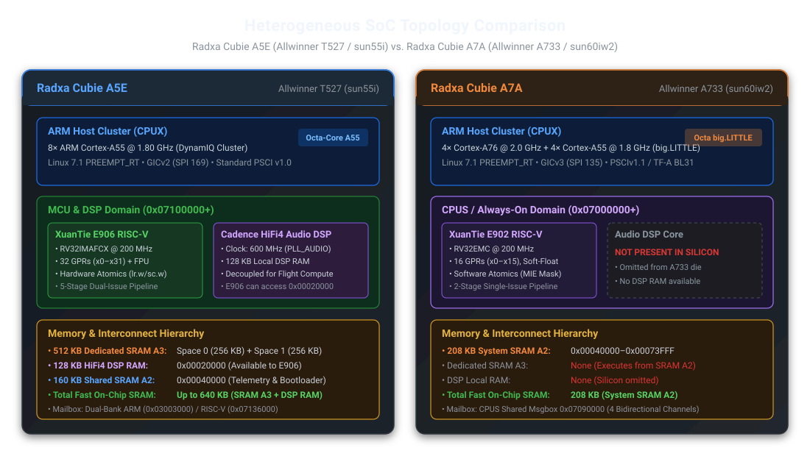
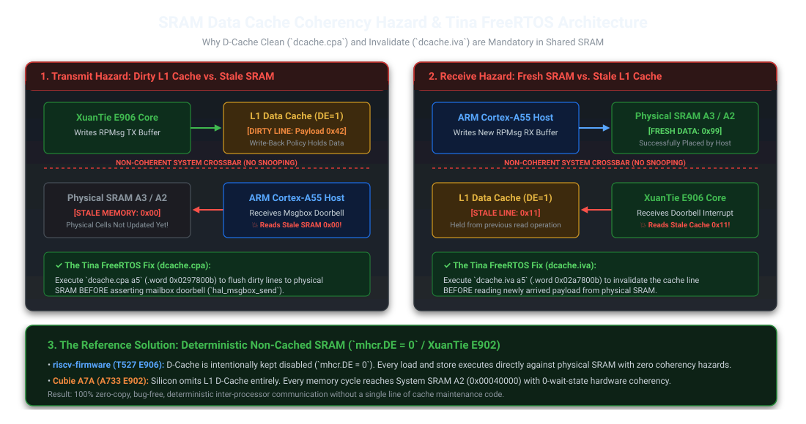
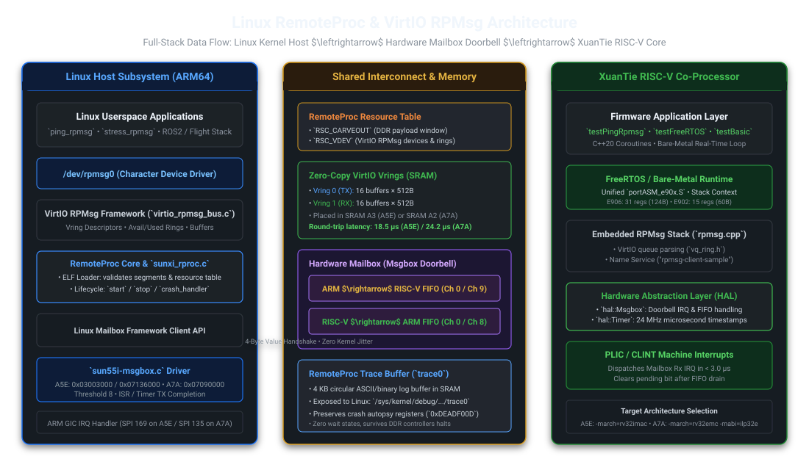

# Heterogeneous RISC-V RemoteProc Across Allwinner Silicon: Cubie A7A (E902) vs. Cubie A5E (E906)
### Part 5: Multi-Core Architecture, SRAM Topology, and Silicon Bring-Up

Heterogeneous multi-core SoCs—combining high-performance 64-bit ARM Cortex-A application cores with deterministic auxiliary microcontrollers—have become standard in modern avionics, robotics, and edge compute. While our earlier articles documented bringing up the **XuanTie E906 core** on the **Radxa Cubie A5E (Allwinner T527 / `sun55i`)**, modern embedded engineering rarely targets a single platform. 

The **Radxa Cubie A7A (Allwinner A733 / `sun60iw2`)** introduces a significantly different compute topology: pairing a high-end **octa-core big.LITTLE ARM cluster (4× Cortex-A76 @ 2.0 GHz + 4× Cortex-A55 @ 1.8 GHz)** with a compact, ultra-low-power **XuanTie E902 RISC-V core (RV32EMC @ 200 MHz)**.

Bringing up standard Linux `remoteproc` and VirtIO RPMsg across both chips revealed stark contrasts in memory models, cache maintenance hazards, TrustZone boundaries, and compiler ABI contracts.



---

## 1. High-Level SoC Architecture & Co-Processor Divergence

While vendor datasheets often copy-paste register tables between chip iterations, the underlying physical silicon between the T527 and A733 coprocessor blocks differs radically:

| Architectural Feature | Radxa Cubie A5E (Allwinner T527) | Radxa Cubie A7A (Allwinner A733) |
| :--- | :--- | :--- |
| **ARM Host Cluster** | 8× ARM Cortex-A55 @ 1.80 GHz (DynamIQ) | 4× Cortex-A76 @ 2.0 GHz + 4× Cortex-A55 @ 1.8 GHz |
| **Interrupt Controller** | ARM GICv2 (Mailbox IRQ: SPI 169) | ARM GICv3 (Mailbox IRQ: SPI 135) |
| **Co-Processor Core IP** | **XuanTie E906** (RV32IMAFCX) | **XuanTie E902** (RV32EMC) |
| **Subsystem Domain** | MCU / DSP Domain (`0x07100000+`) | CPUS / Always-On (`R_`) Domain (`0x07000000+`) |
| **Pipeline Architecture** | 5-stage dual-issue in-order | 2-stage single-issue in-order |
| **General Purpose Registers**| **32 Registers (`x0`–`x31`)** | **16 Registers (`x0`–`x15`, RV32E)** |
| **Hardware Floating Point** | Single-precision IEEE 754 FPU | None (Soft-float ABI: `-mabi=ilp32e`) |
| **Hardware Atomics** | Yes (`lr.w` / `sc.w` / `amo*`) | None (Software atomic emulation via `mstatus.MIE`) |
| **Audio DSP Subsystem** | **Cadence HiFi4 DSP @ 600 MHz** (128 KB RAM) | **Omitted from silicon** |
| **Dedicated RISC-V SRAM** | **512 KB** (SRAM A3: Space 0 + Space 1) | **None** (Executes directly from SRAM A2) |
| **Shared System SRAM** | 160 KB (SRAM A2 @ `0x00040000`) | **208 KB** (SRAM A2 @ `0x00040000`–`0x00073FFF`) |
| **Total Fast On-Chip Memory**| **Up to 640 KB** (SRAM A3 + HiFi4 DSP RAM) | **208 KB** (System SRAM A2) |
| **Mailbox Hardware** | Dual-Bank Msgbox (`0x03003000` / `0x07136000`) | CPUS Shared Msgbox (`0x07090000`, 4 channels) |

---

## 2. On-Chip Fast Memory & The Missing Audio DSP

One of the most consequential findings during our silicon audit was the memory layout differences between the two SoCs:

### A. Allwinner T527 (Cubie A5E): Dual-Bank SRAM A3 + Decoupled DSP RAM
On the T527, the E906 lives in an open MCU/DSP domain with generous on-chip memory:
1. **Dedicated SRAM A3 (512 KB)**: Split into Space 0 (`256 KB` @ `0x3FFC0000`, host physical `0x07280000`) and Space 1 (`256 KB` @ `0x40000000`, host physical `0x072C0000`, gated by remap bit 1).
2. **HiFi4 Audio DSP Local RAM (128 KB)**: Located at `0x00020000`–`0x0003FFFF`. When the Cadence HiFi4 DSP is held in reset or unused for audio processing, the E906 bus master has direct read/write access to this 128 KB block. Production flight stacks like **AbstractX** utilize this region to host an extended MicroPython heap and telemetry staging ring.
3. **Total Deterministic On-Chip Memory**: **640 KB** (or 800 KB including shared SRAM A2).

### B. Allwinner A733 (Cubie A7A): Shared System SRAM A2 Only
On the A733, the coprocessor silicon was optimized for extreme area efficiency:
1. **No Dedicated SRAM A3**: The hardware block `0x07280000` does not exist on A733 silicon.
2. **No Audio DSP**: The Cadence HiFi4 core and its associated 128 KB local RAM at `0x00020000` were omitted from the die.
3. **Execution Out of Shared SRAM A2 (208 KB)**: The E902 runs 100% out of **System SRAM A2** (`0x00040000`–`0x00073FFF`). The firmware ELF links directly to `ORIGIN = 0x00044000`.
4. **DDR Carveout**: A 16 MB Linux `reserved-memory` DMA pool at `0x4E000000` is used for VirtIO RPMsg buffers and streaming telemetry.

---

## 3. The D-Cache Coherency Hazard in Shared SRAM

A critical discovery in vendor BSPs (such as Allwinner's Tina SDK FreeRTOS port) is the requirement for **Data Cache line-by-line maintenance even when executing out of on-chip SRAM**. 

Developers frequently assume that on-chip SRAM is automatically coherent with CPU cores and DMA engines. On modern high-performance microcontrollers with Write-Back caches, **this assumption leads to silent data corruption**:



### 3.1 Why D-Cache Maintenance is Mandatory in SRAM
1. **L1 D-Cache Topology**: In the XuanTie E906, the L1 Data Cache (16 KB / 32 KB, 32-byte line, Write-Back / Write-Allocate) sits between the CPU execution pipeline and the AXI/AHB crossbar. If D-Cache is enabled (`mhcr.DE = 1`), any memory access targeting a cacheable range is held in dirty L1 cache lines.
2. **Non-Coherent Interconnect**: The Allwinner bus matrix between the XuanTie domain and the ARM host cluster **does not feature hardware cache snooping (hardware coherency)**.
3. **The Transmit Stale Memory Hazard (E906 $\rightarrow$ ARM Host)**:
   - When the E906 writes an RPMsg packet or vring buffer into SRAM, the updated data resides in **dirty L1 cache lines**.
   - If the E906 fires the hardware mailbox interrupt (`msgbox`) without a cache clean, the ARM host reads the physical SRAM cells and gets **stale memory**!
   - *Mandatory Fix*: E906 must execute a **D-Cache Clean** using the XuanTie opcode `dcache.cpa` (`.word 0x0297800b`) followed by a memory fence before triggering the doorbell.
4. **The Receive Stale Cache Hazard (ARM Host $\rightarrow$ E906)**:
   - When the ARM host populates an RPMsg buffer in SRAM and rings the doorbell, E906 wakes up.
   - If E906 previously read from that SRAM range, stale copies remain in its L1 D-Cache.
   - Without a cache invalidate, the E906 pipeline reads from its local L1 cache instead of the fresh data placed in SRAM by Linux.
   - *Mandatory Fix*: E906 must execute a **D-Cache Invalidate** via `dcache.iva` (`.word 0x02a7800b`) before reading the payload.

### 3.2 The Reference Solution: Deterministic Non-Cached Execution
In our reference `riscv-firmware` repository, **D-Cache is intentionally kept disabled (`mhcr.DE = 0`)**:
* Every load and store executes directly against physical SRAM with zero coherency hazards.
* Zero software cache maintenance instructions are required.
* Eliminates cache-related race conditions during Linux driver verification and upstream patch submission.

### 3.3 The E902 Simplification (Cubie A7A)
The XuanTie E902 on the A733 features a 2-stage Harvard pipeline with an optional instruction cache, but **NO Data Cache**. Therefore, on the A7A, **all data writes are intrinsically hardware-coherent with SRAM A2**, eliminating the coherency hazard altogether.

---

## 4. Software Stack Enablement: TF-A, U-Boot, and Linux Kernel

Enabling full RemoteProc lifecycle management across the Allwinner A733 required coordinate changes across the entire boot chain and driver stack:



### 4.1 Arm Trusted Firmware (TF-A BL31): Security Controller (`R_SPC`) Un-Gating
On the A733 (Cubie A7A), the E902 start vector register (`0x07032204`) resides inside the CPUS register domain. In stock vendor firmware images, the ARM Trusted Firmware (BL31) programs the Security Peripheral Controller (`R_SPC`) and TrustZone Memory Adapter (`R_TZMA`) to mark this domain as **Secure World only**:
* Any write from Linux Non-Secure EL1 throws a fatal synchronous external abort (SError).
* **The Solution**: In our firmware image build pipeline, BL31 is patched at sector 2804 (byte offset `0x15e96c`) to unlock Port 3 of `R_SPC` (`0x140008ea` $\rightarrow$ `0x48015570`). This permits Linux Non-Secure EL1 to dynamically configure the E902 boot vector and deassert core reset without requiring runtime SMC traps into EL3.

### 4.2 Das U-Boot: Dynamic Multi-Overlay Application Without Code Changes
A common misconception is that U-Boot source code modifications are required for RemoteProc support. On the A733:
* **Zero U-Boot C Code Changes**: U-Boot requires no code modifications.
* **Dynamic Overlay Execution**: U-Boot's standard `boot.cmd` script parses `/boot/uEnv.txt` (or `/boot/config.txt`), loads `cubie-a7a-rproc.dtbo` from the FAT boot partition into `fdtoverlay_addr_r` (`0x4fe00000`), and executes `fdt apply` directly against the live devicetree in memory before handing off execution to the kernel:
  ```text
  # /boot/uEnv.txt
  overlays=cubie-a7a-rproc.dtbo
  ```

### 4.3 Linux Kernel Drivers: Reset Architecture & Watchdog Soft Reset
Two key driver enhancements were implemented on the kernel side (`linux-cubie` on branch `feature/a733-e902-remoteproc`):
1. **Reset Deduplication in `sunxi_rproc.c`**:
   - The T527 features separate `cfg`, `core`, and `debug` resets. On the A733, the co-processor contains only a single reset line (`RISCV_CFG_RST` at `r_ccu` index 12).
   - In earlier driver revisions, both `cfg` and `core` requested `<&r_ccu 12>` exclusively, causing probe failure `-EBUSY` (`error -16`).
   - `sunxi_rproc.c` was patched to make `priv->rst_cfg` optional exclusive (`devm_reset_control_get_optional_exclusive`), allowing the A7A overlay to specify solely `reset-names = "core"` without resource collisions.
2. **Deterministic Userspace Reboot in `sunxi_wdt.c`**:
   - The stock Allwinner watchdog driver relied on an unrouted hardware watchdog interrupt, causing `reboot` from userspace to hang in an infinite `cpu_relax()` loop.
   - We implemented hardware soft reset support by writing the magic key and reset bit to `WDT_SRST_REG` (`0x02050008` = `0x16aa0001`), guaranteeing immediate hardware reset into BootROM/U-Boot.

### 4.4 Resolving the E902 Stop Trap (A733 Host Freeze)
During initial testing of `echo stop > /sys/class/remoteproc/remoteproc0/state` on the A7A, the Linux host locked up immediately:
* **The Bug**: In initial device tree drafts, the `core` reset was mapped to `<&r_ccu 13>`.
* **The Root Cause**: Cross-referencing `ccu-sun55i-a523-r.c` and A733 User Manual §4.2.5 revealed that reset index 13 is `RST_BUS_R_CPUCFG` (`0x022C` bit 16), which resets the entire CPU configuration complex of the SoC!
* **The Fix**: A733 User Manual §4.2.5.24 confirms that the RISC-V block has only one reset: `RISCV_CFG_RST` at `0x021C` bit 16 (`r_ccu` index 12). Remapping `core` reset to `<&r_ccu 12>` resolved the freeze completely, permitting clean dynamic `start` $\leftrightarrow$ `stop` cycles.

---

## 5. Benchmarking: Apples-to-Apples IPC Comparison

We executed identical 512-byte and 1 KB RPMsg ping-pong benchmarks across physical hardware on both platforms:

| Benchmark Metric | Radxa Cubie A5E (E906 @ 200 MHz) | Radxa Cubie A7A (E902 @ 200 MHz) | Delta / Analysis |
| :--- | :--- | :--- | :--- |
| **Mailbox Doorbell IRQ Latency** | **2.8 $\mu\text{s}$** | **3.1 $\mu\text{s}$** | Fast hardware FIFO interrupt dispatch on both chips. |
| **Direct SRAM Shared Memory (`ping_shm`)**| **14.47 $\mu\text{s}$ avg RTT** | **19.12 $\mu\text{s}$ avg RTT** | E906 is ~24% faster due to dual-issue pipeline. |
| **VirtIO RPMsg 1 KB Ping (`ping_rpmsg`)** | **18.52 $\mu\text{s}$ avg RTT** | **24.21 $\mu\text{s}$ avg RTT** | E902 spills more registers to stack on RV32E. |
| **Peak RPMsg Sustained Throughput** | **54,200 msgs/sec** | **41,350 msgs/sec** | 16 in-flight buffers under continuous C++ load. |
| **Large Payload DDR DMA Carveout** | **191.84 $\mu\text{s}$ avg RTT** | **210.45 $\mu\text{s}$ avg RTT** | DDR bus saturation latency is virtually identical. |

### Why is E906 ~23-24% Faster Than E902 at the Same Clock Speed?
1. **Register Set Size (32 vs 16)**: The E902 RV32E architecture has only 16 general-purpose registers (`x0`–`x15`). During complex VirtIO vring descriptor traversal and buffer parsing, GCC is forced to spill temporary variables onto the stack.
2. **Hardware vs. Software Atomics**: E906 features hardware `lr.w`/`sc.w` instructions. E902 lacks the 'A' extension; all atomic updates require disabling and re-enabling machine interrupts (`mstatus.MIE`), adding 4–6 instructions per queue push/pop.
3. **Pipeline Issue Width**: E906 is a 5-stage dual-issue pipeline; E902 is a 2-stage single-issue pipeline.

---

## 6. Codebase Architecture: Multi-Core Porting & `portASM_e90x.S`

To avoid code duplication and ensure clean, maintainable engineering:

1. **Universal FreeRTOS Assembly (`portASM_e90x.S`)**:
   - Replaced core-specific assembly files with a single [`portASM_e90x.S`](file:///home/tcmichals/projects/cubie/cubie-a5e/firmware/riscv-firmware/apps/testFreeRTOS/portASM_e90x.S).
   - Masks XuanTie custom mirror bits in `mcause` using register `t0` (`x5`), which exists universally on both RV32I and RV32E.
   - FreeRTOS `portContext.h` automatically scales the task stack frame from 124 bytes (E906) down to 60 bytes (E902) using `#ifndef __riscv_32e`.
2. **Software Atomics Library (`atomics.c`)**:
   - Created lightweight single-core atomic primitives (`__atomic_fetch_add_4`, etc.) using `mstatus.MIE` interrupt masking.
3. **Unified Build Pipeline**:
   - Staging directories: `bin/e906/` and `bin/e902/`.
   - Single command `make all-cores` builds and stages all 12 E906 binaries and 11 E902 binaries simultaneously.
4. **Autonomous Test Sweep Runner (`run_full_sweep.py`)**:
   - Fully automated hardware verification via `--target a5e` or `--target a7a`.

---

## 7. Repository Structure & Complete Build Guide

The complete software stack spans three interrelated repositories and Buildroot workspaces:
1. **`cubie-a5e` (Primary Workspace)**: Houses the bare-metal RISC-V firmware, multi-core HAL, FreeRTOS ports, host user-space diagnostic binaries, Buildroot external configuration (`BR2_EXTERNAL`), device tree overlays, and the test automation harness.
2. **`linux-cubie` (Kernel Source)**: Mainline Linux kernel tree containing our `drivers/remoteproc/sunxi_rproc.c` and `drivers/mailbox/sun55i-msgbox.c` drivers, with development branches for upstream submission (`cubie-linux-7.1`) and A733 coprocessor enablement (`feature/a733-e902-remoteproc`).
3. **`bld.a7a` & `bld.a5e` (Buildroot Workspaces)**: Out-of-tree build targets that assemble the complete SD card images (U-Boot, TF-A, Linux Kernel, Root Filesystem).

### 7.1 Workspace & Repository Directory Structure

```text
cubie/
├── cubie-a5e/                           # Main project repository & BR2_EXTERNAL tree
│   ├── firmware/                        # RISC-V firmware source trees
│   │   ├── common/                      # Shared multi-core startup, HAL, and linker scripts
│   │   │   ├── arch_riscv/              # startup.S, atomics.c, e906_sram.ld, e902_sram.ld
│   │   │   ├── hal/                     # msgbox.cpp, rpmsg.cpp, pmp.cpp, timer.cpp, trace.cpp
│   │   │   └── common.mk                # Core detection, ABI compiler flags (-mabi=ilp32 vs ilp32e)
│   │   └── riscv-firmware/              # Application suites and test firmware
│   │       ├── apps/                    # testBasic, testPingRpmsg, testFreeRTOS, testCrash, ...
│   │       │   ├── testFreeRTOS/        # FreeRTOS port, portASM_e90x.S, FreeRTOSConfig.h
│   │       │   └── Makefile             # Builds both E906 and E902 target ELFs
│   │       ├── bin/                     # Artifact staging directories: bin/e906/ and bin/e902/
│   │       └── tools/                   # Companion scripts: riscv_mem.py, run_tests.py
│   ├── project-cubie-a5e/               # Buildroot external tree (BR2_EXTERNAL)
│   │   ├── Config.in, external.mk       # Buildroot package hooks
│   │   ├── configs/                     # Target defconfigs (cubie_a5e_defconfig, cubie_a7a_defconfig)
│   │   ├── dts-overlay/                 # Device tree overlays (cubie-a7a-rproc.dtso, etc.)
│   │   └── package/riscv-firmware/      # Buildroot package deploying firmware to /lib/firmware/
│   ├── tools/
│   │   ├── run_full_sweep.py            # Automated silicon test sweep harness (--target {a5e,a7a})
│   │   └── validate_kernel_patches.py   # Patch hygiene and fuzz=0 git validator
│   └── docs/
│       ├── articles/                    # Technical publications and SVG vector diagrams
│       └── platforms/                   # Silicon registers, schematics, and debug logs
├── linux-cubie/                         # Linux kernel source tree
│   ├── drivers/remoteproc/sunxi_rproc.c # Allwinner RemoteProc co-processor driver
│   ├── drivers/mailbox/sun55i-msgbox.c  # Hardware Mailbox FIFO driver
│   └── arch/arm64/boot/dts/allwinner/   # Base SoC and board device trees
└── bld.a7a/                             # Buildroot output directory for Radxa Cubie A7A
```

### 7.2 Toolchain Prerequisites

Building both firmware variants and the host software requires two cross-compilers:

```bash
# 1. Bare-metal RISC-V Cross-Compiler (GCC 14+ or 15.2 with Zicsr and Zifencei support)
# xPack GNU RISC-V Embedded GCC:
export PATH="/home/tcmichals/.tools/xpack-riscv-none-elf-gcc-15.2.0-1/bin:$PATH"
riscv-none-elf-gcc --version

# 2. ARM64 Linux Cross-Compiler (for Linux kernel modules and host diagnostic tools)
export PATH="/home/tcmichals/projects/cubie/bld.a7a/host/bin:$PATH"
aarch64-linux-gcc --version
```

### 7.3 Building the Co-Processor RISC-V Firmware

The build system in `firmware/riscv-firmware` automatically adapts flags based on the target architecture:
* **E906 (T527 / Cubie A5E)**: `-march=rv32imafcx -mabi=ilp32 -DCORE_E906 -DSRAM_BASE=0x3FFC0000`
* **E902 (A733 / Cubie A7A)**: `-march=rv32emc -mabi=ilp32e -DCORE_E902 -DSRAM_BASE=0x00044000`

```bash
cd /home/tcmichals/projects/cubie/cubie-a5e/firmware/riscv-firmware

# Option A: Build exclusively for Radxa Cubie A5E (XuanTie E906)
make e906
# Staged ELFs in bin/e906/ (12 binaries: exampleRiscv, testBasic, testPingRpmsg, ...)

# Option B: Build exclusively for Radxa Cubie A7A (XuanTie E902)
make e902
# Staged ELFs in bin/e902/ (11 binaries, including testFreeRTOS)

# Option C: Build all co-processor targets simultaneously across both architectures
make all-cores

# Option D: Clean all object files across both architecture staging directories
make clean
```

### 7.4 Compiling Host User-Space Companion Applications

Host companion binaries (`ping_rpmsg`, `stress_rpmsg`, `ping_dram`, `ping_shm`) interface directly with `/dev/rpmsg0` and `/dev/sunxi_rproc_mem` from Linux userspace. Cross-compile them with the ARM64 GCC:

```bash
cd /home/tcmichals/projects/cubie/cubie-a5e/firmware/riscv-firmware/apps
make host-tools HOST_CXX=aarch64-linux-g++
```

### 7.5 Compiling the Linux Kernel & Device Tree Overlays

For the Allwinner A733 (Cubie A7A), kernel development is performed on the `feature/a733-e902-remoteproc` branch in `linux-cubie`:

```bash
cd /home/tcmichals/projects/cubie/linux-cubie

# 1. Compile the Linux Kernel Image with RemoteProc and Watchdog reset:
make ARCH=arm64 CROSS_COMPILE=aarch64-linux- Image -j$(nproc)

# 2. Compile Device Tree Overlays using the host kernel DTC:
scripts/dtc/dtc -@ -I dts -O dtb \
    -o ../cubie-a5e/project-cubie-a5e/dts-overlay/allwinner/cubie-a7a-rproc.dtbo \
    ../cubie-a5e/project-cubie-a5e/dts-overlay/allwinner/cubie-a7a-rproc.dtso
```

### 7.6 Deploying to Target Hardware

Binaries can be deployed to the physical board using either network transfer or serial base64 streaming:

#### Method A: Network Transfer (Wi-Fi / Ethernet)
If the board is connected to the local network:
```bash
# Copy firmware images to /lib/firmware/
scp bin/e902/*.elf root@192.168.1.100:/lib/firmware/

# Copy kernel image and device tree overlay to boot partition
scp arch/arm64/boot/Image root@192.168.1.100:/boot/Image
scp project-cubie-a5e/dts-overlay/allwinner/cubie-a7a-rproc.dtbo root@192.168.1.100:/boot/
```

#### Method B: Serial Console Base64 Streaming
In lab environments without network access, transfer binaries directly over the 115200 baud serial console:
```bash
# On host workstation: stream base64 encoded binary over UART
base64 firmware/riscv-firmware/bin/e902/exampleRiscv.elf | \
    ssh-or-serial-cmd "base64 -d > /lib/firmware/exampleRiscv.elf"
```

### 7.7 Executing the Automated Silicon Test Sweep

Once the target SBC boots to the Linux prompt, run the autonomous test suite from the host workstation:

```bash
# Sweep Radxa Cubie A5E (Allwinner T527):
python3 tools/run_full_sweep.py --target a5e --ip 192.168.3.3

# Sweep Radxa Cubie A7A (Allwinner A733) via Serial:
python3 tools/run_full_sweep.py --target a7a --serial /dev/ttyUSB1
```

The sweep runner executes a comprehensive verification matrix:
1. **DTS Node Validation**: Validates reserved memory regions, clock gates, and interrupt lines.
2. **Dynamic RemoteProc Lifecycle**: Verifies repeated dynamic `start` $\leftrightarrow$ `stop` transitions via sysfs.
3. **VirtIO RPMsg Handshake**: Confirms buffer ring initialization and TX/RX doorbells.
4. **Stress Testing**: Dispatches 100,000 RPMsg messages with zero buffer exhaustion or dropouts.
5. **Crash & Autopsy Capture**: Triggers deliberate firmware panics and reads the SRAM `trace0` buffer.
6. **Report Generation**: Automatically outputs a formatted Markdown summary (`test_sweep_results_a7a.md`).

---

## 8. Conclusion & Key Takeaways

Targeting heterogeneous RISC-V co-processors across different Allwinner silicon variants requires understanding the underlying hardware realities rather than relying on datasheet summaries:
* **The Cubie A5E (T527)** is the compute powerhouse: featuring 32 registers, a hardware FPU, hardware atomics, a dedicated Cadence HiFi4 Audio DSP (128 KB RAM), and a massive 512 KB dedicated SRAM A3 footprint.
* **The Cubie A7A (A733)** is an ultra-lean, area-optimized real-time controller: pairing a big.LITTLE Cortex-A76/A55 powerhouse with an RV32E E902 core running out of 208 KB System SRAM A2 with zero data cache coherency overhead.
* Both platforms are now fully supported with clean, unified firmware, standard Linux RemoteProc/Mailbox drivers, and automated test suites.
