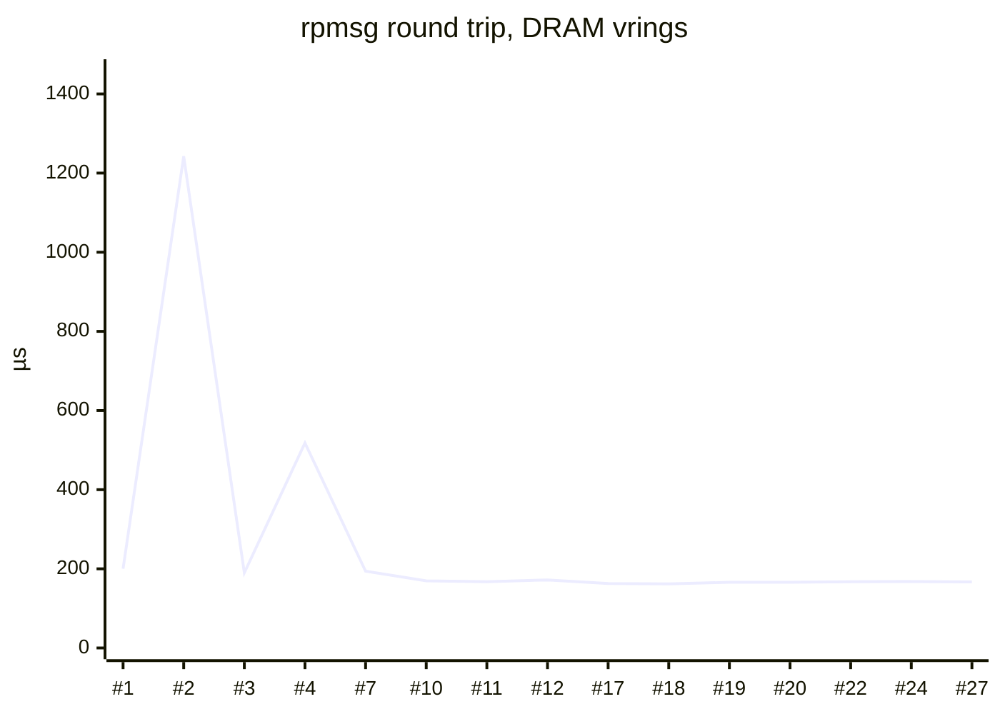
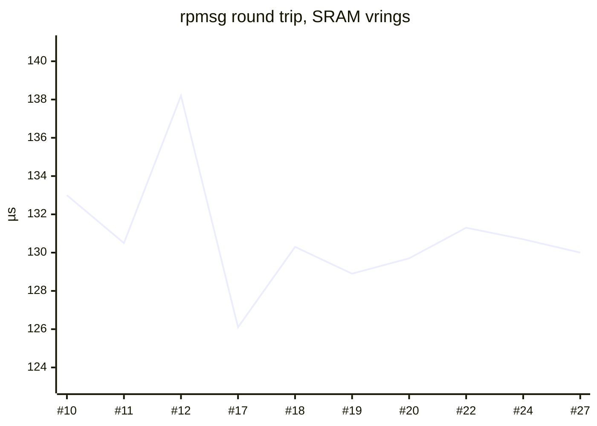
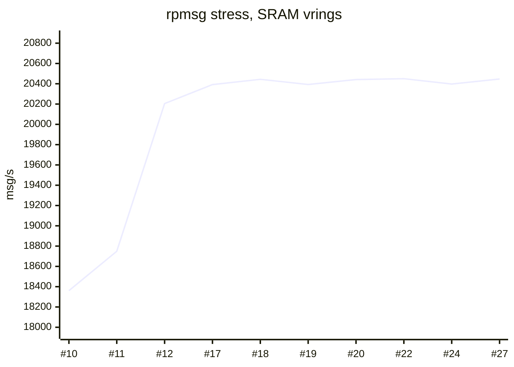
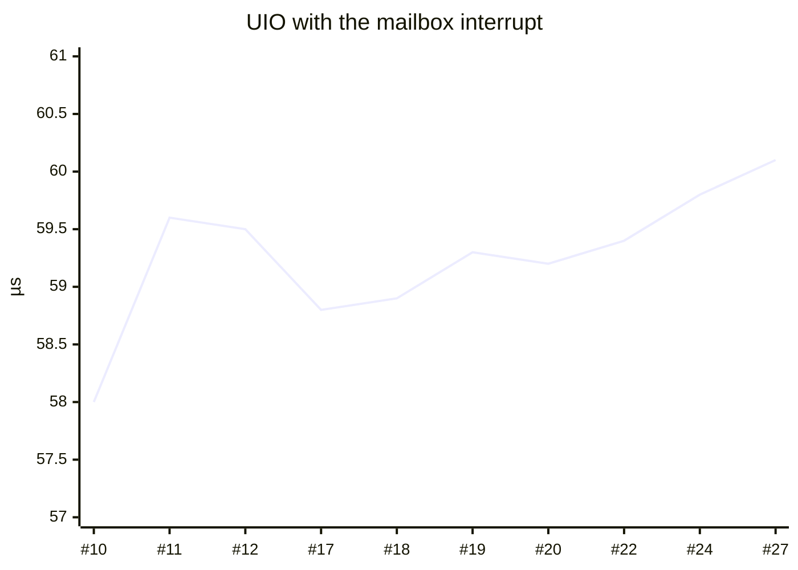

# Full Sweep Tests

Every full sweep (`tools/run_full_sweep.py`) on the Radxa Cubie A5E, from the first run to now: the E906 remoteproc, message box, rpmsg and UIO paths, KUnit on the board, and the performance of each IPC path. Generated from [`test_sweep_history.json`](https://github.com/tcmichals/cubie-a5e/blob/main/test_sweep_history.json) by `tools/make_sweep_wiki.py`; do not edit by hand.

**27 runs** from 2026-10-02 to 2026-10-29: 17 PASS, 10 FAIL. Kernel flavors: `preempt`, `preempt+lockdep`, `rt`. Latest: run #27 on `0a77050147bd` (rt), **PASS**, KUnit 63/63.

## Current performance (PREEMPT_RT)

Median and range over the last 10 passing RT runs (#10–#27).

| Path | Median | Min | Max | Spread | Latest |
|---|---:|---:|---:|---:|---:|
| rpmsg ping round trip, vrings in DRAM (Profile 1) | 167.0 µs | 161.8 | 172.0 | 6% | 166.8 |
| rpmsg ping jitter, DRAM | 8.8 µs | 7.9 | 22.3 | 163% | 9.3 |
| rpmsg ping rate, DRAM | 5,956 msg/s | 5,786 | 6,151 | 6% | 5,967 |
| rpmsg ping round trip, vrings in SRAM (Profile 2) | 130.4 µs | 126.1 | 138.2 | 9% | 130.0 |
| rpmsg ping rate, SRAM | 7,618 msg/s | 7,187 | 7,885 | 9% | 7,653 |
| rpmsg stress, DRAM, 16 in flight | 11,519 msg/s | 11,144 | 11,580 | 4% | 11,571 |
| rpmsg stress, SRAM, 16 in flight | 20,395 msg/s | 18,361 | 20,450 | 10% | 20,447 |
| ping, firmware in DRAM | 194.2 µs | 189.6 | 201.8 | 6% | 192.2 |
| ping rate, firmware in DRAM, 16 in flight | 5,090 msg/s | 5,002 | 5,155 | 3% | 5,123 |
| UIO direct to SRAM, polling (Profile 3) | 13.7 µs | 13.5 | 14.7 | 9% | 13.6 |
| UIO direct, rate | 8,983 msg/s | 8,789 | 8,995 | 2% | 8,984 |
| UIO direct, bandwidth | 8.8 MB/s | 8.6 | 8.8 | 2% | 8.8 |
| UIO with the mailbox interrupt | 59.3 µs | 58.0 | 60.1 | 3% | 60.1 |
| UIO from Python | 32.5 µs | 32.0 | 35.9 | 12% | 35.5 |
| message box ping, TX done by poll | 167.2 µs | 166.6 | 167.2 | 0% | 166.6 |
| message box ping p99, poll | 194.5 µs | 193.2 | 194.8 | 1% | 193.2 |
| message box ping, TX done by write interrupt | 167.0 µs | 166.6 | 167.3 | 0% | 167.0 |
| message box ping p99, write interrupt | 195.0 µs | 192.3 | 195.9 | 2% | 192.3 |
| FreeRTOS firmware ping, poll | 193.6 µs | 191.5 | 195.1 | 2% | 191.5 |
| FreeRTOS firmware ping, write interrupt | 187.6 µs | 187.5 | 191.0 | 2% | 187.5 |

## Kernel flavors

Latest passing run of each flavor.

| Path | `rt` (#27) | `preempt` (#25) | `preempt+lockdep` (#26) |
|---|---:|---:|---:|
| rpmsg ping round trip, vrings in DRAM (Profile 1) | 166.8 µs | 147.0 µs | 364.9 µs |
| rpmsg ping round trip, vrings in SRAM (Profile 2) | 130.0 µs | 112.8 µs | 334.9 µs |
| rpmsg ping rate, DRAM | 5,967 msg/s | 6,772 msg/s | 2,730 msg/s |
| rpmsg stress, SRAM, 16 in flight | 20,447 msg/s | 20,481 msg/s | 9,370 msg/s |
| UIO with the mailbox interrupt | 60.1 µs | 27.9 µs | 27.2 µs |
| UIO from Python | 35.5 µs | 49.8 µs | 66.2 µs |
| message box ping p99, write interrupt | 192.3 µs | 165.8 µs | 449.8 µs |

## Trends (PREEMPT_RT, passing runs)

Runs before #8 used TX done by the 1 ms poll with the old FIFO pacing; the spikes are messages that waited a full poll period.

## Phases

| Phase | Runs | What changed |
|---|---|---|
| Early drivers (10-02 to 10-03) | #1–4 | All PASS, but the rpmsg round trip swung between 190 µs and 1,242 µs (jitter up to 600 µs, 720–3,000 msg/s): with TX done by the 1 ms poll timer, a message sometimes waited a full poll period. |
| Invariant fixes (10-14) | #5–7 | The sweep's source checks caught three rule breaks: the remoteproc driver reported TX done itself (`knows_txdone`), the FIFO pacing was wrong, and the benchmark slept. All fixed. |
| TX done = FIFO has room (10-15 to 10-20) | #8–20 | A kick is a doorbell, so it is done once the receiver's FIFO has room (DESIGN_DECISIONS "Message box TX completion"). Round trip ~200 → 167 µs, rate about doubled to ~6,000 msg/s, jitter 600 → ~8 µs. Stress, SRAM-vring and UIO-interrupt metrics added from #10. The Profile 3 UIO numbers changed meaning at #8 (benchmark method, `6a3eb45`, `6779369`): earlier values are not comparable. |
| v3 hardening (10-27 on) | #21– | Final v3 code: 63 KUnit cases (37 message box, 26 remoteproc), message box latency per TX-done mode (#22 on), extra-RAM test (E906 uses DSP RAM, the DRAM carveout and SRAM A3_2), PREEMPT and lockdep kernels. |

## Why runs failed

- **#5, #6**: the invariant breaks above.
- **#8, #9, #13**: a functional row failed (#9 did not run Profile 1). The history keeps metrics, not which row failed.
- **#14–16**: the TX-completion check, while that rule was being reworked (10-16/17).
- **#21**: 2 KUnit cases failed under PREEMPT_RT (the TX-done IRQ ran in its IRQ thread, outside the test's stubs) and Profile 3 did not run. Fixed in `97f6e462ba87`.
- **#23**: the new extra-RAM step ran before the FreeRTOS pings and broke them; moved after them (#24 PASS).

No driver regression in the v3 runs. Note: from #21 to #27 two source checks (TX completion, drain bound) reported FAIL on correct code, because they matched text the 10-26 refactor changed; they do not count toward the result and were fixed on 10-29 (`b44a031`).

## Reading the numbers

- Profile 1: rpmsg with vrings in DRAM. Profile 2: vrings in SRAM. Profile 3: userspace UIO straight to the mailbox and SRAM, no rpmsg.
- RT = PREEMPT_RT, the board's normal kernel. On PREEMPT (non-RT) the interrupt paths are faster, because RT runs interrupt handlers in threads. Lockdep costs 2–3x on every lock-heavy path, as expected.
- The range check compares each run with the median of the last 10 PASS runs of the same kernel flavor; a SLOW result fails the sweep.

## Every run

| Run | Date | Kernel | Flavor | Result | KUnit | DRAM RTT | SRAM RTT | SRAM stress | UIO IRQ |
|---:|---|---|---|---|---:|---:|---:|---:|---:|
| #27 | 2026-10-29 06:29 | `0a77050147bd` | rt | PASS | 63/63 | 166.8 | 130.0 | 20,447 | 60.1 |
| #26 | 2026-10-28 19:21 | `8671beca6667` | preempt+lockdep | PASS | 63/63 | 364.9 | 334.9 | 9,370 | 27.2 |
| #25 | 2026-10-28 18:50 | `8671beca6667` | preempt | PASS | 63/63 | 147.0 | 112.8 | 20,481 | 27.9 |
| #24 | 2026-10-28 17:31 | `8671beca6667` | rt | PASS | 63/63 | 167.8 | 130.7 | 20,397 | 59.8 |
| #23 | 2026-10-28 17:24 | `8671beca6667` | rt | **FAIL** | 63/63 | 168.4 | 130.0 | 20,446 | 59.5 |
| #22 | 2026-10-27 18:51 | `b19a950e320c` | rt | PASS | 61/63 | 167.5 | 131.3 | 20,450 | 59.4 |
| #21 | 2026-10-27 18:38 | `b19a950e320c` | rt | **FAIL** | 61/63 | 168.3 | 130.4 | 20,448 | – |
| #20 | 2026-10-20 21:59 | `d64ff2579e08` | rt | PASS | 54/54 | 166.1 | 129.7 | 20,441 | 59.2 |
| #19 | 2026-10-20 21:23 | `d64ff2579e08` | rt | PASS | 51/51 | 165.9 | 128.9 | 20,393 | 59.3 |
| #18 | 2026-10-17 14:43 | `82b64e947b5b` | rt | PASS | 51/51 | 161.8 | 130.3 | 20,444 | 58.9 |
| #17 | 2026-10-17 14:24 | `82b64e947b5b` | rt | PASS | 51/51 | 162.7 | 126.1 | 20,392 | 58.8 |
| #16 | 2026-10-17 13:06 | `82b64e947b5b` | rt | **FAIL** | 51/51 | 172.7 | 133.4 | 19,490 | 58.8 |
| #15 | 2026-10-17 12:33 | `82b64e947b5b` | rt | **FAIL** | 51/51 | 169.7 | 134.7 | 19,105 | 59.6 |
| #14 | 2026-10-17 11:51 | `82b64e947b5b` | rt | **FAIL** | 51/51 | 167.6 | 136.6 | 19,015 | 58.8 |
| #13 | 2026-10-16 21:01 | `82b64e947b5b` | rt | **FAIL** | 47/47 | 170.5 | 136.7 | 20,187 | 59.4 |
| #12 | 2026-10-16 20:16 | `82b64e947b5b` | rt | PASS | 47/47 | 172.0 | 138.2 | 20,205 | 59.5 |
| #11 | 2026-10-16 04:10 | `82b64e947b5b` | rt | PASS | 47/47 | 167.2 | 130.5 | 18,749 | 59.6 |
| #10 | 2026-10-15 19:13 | `71b7756b25bb` | rt | PASS | 47/47 | 169.7 | 133.0 | 18,361 | 58.0 |
| #9 | 2026-10-15 05:01 | `71b7756b25bb` | rt | **FAIL** | 47/47 | – | 133.7 | – | – |
| #8 | 2026-10-15 04:54 | `39e8db786df7` | rt | **FAIL** | 47/47 | 166.5 | 130.7 | – | – |
| #7 | 2026-10-14 21:59 | `39e8db786df7` | rt | PASS | 47/47 | 193.9 | 133.9 | – | – |
| #6 | 2026-10-14 21:56 | `39e8db786df7` | rt | **FAIL** | 47/47 | 517.1 | 134.2 | – | – |
| #5 | 2026-10-14 18:12 | `64c3c511452a` | rt | **FAIL** | 47/67 | 1,242.7 | 132.4 | – | – |
| #4 | 2026-10-03 00:04 | `b861276e3e76` | rt | PASS | 67/67 | 517.8 | 136.4 | – | – |
| #3 | 2026-10-02 23:51 | `b861276e3e76` | rt | PASS | 67/67 | 189.9 | 140.1 | – | – |
| #2 | 2026-10-02 23:46 | `b861276e3e76` | rt | PASS | 67/67 | 1,242.4 | 143.1 | – | – |
| #1 | 2026-10-02 23:38 | `b861276e3e76` | rt | PASS | 67/67 | 200.2 | 142.7 | – | – |

RTT in µs, stress in msg/s. Full per-run data: [`test_sweep_history.md`](https://github.com/tcmichals/cubie-a5e/blob/main/test_sweep_history.md).
